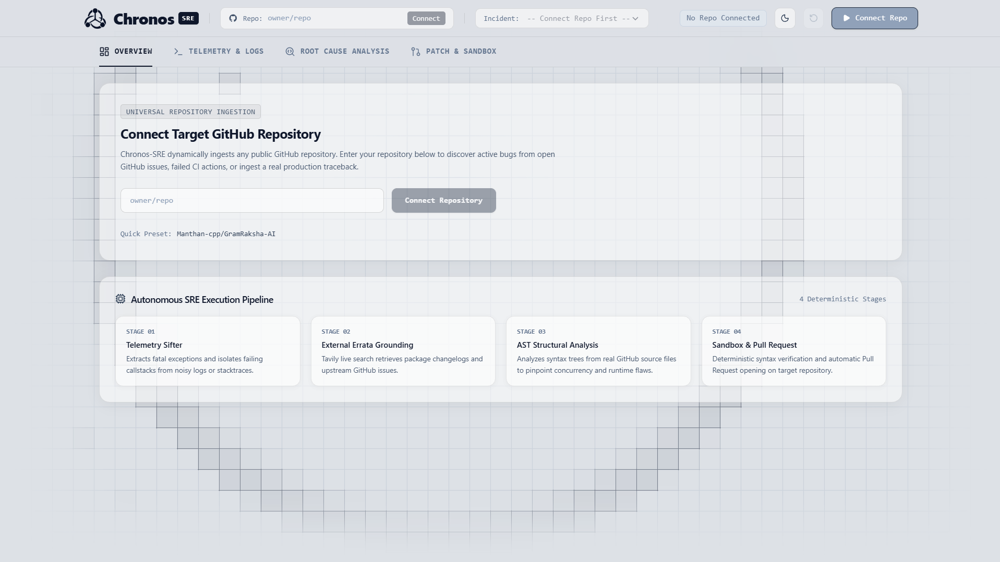
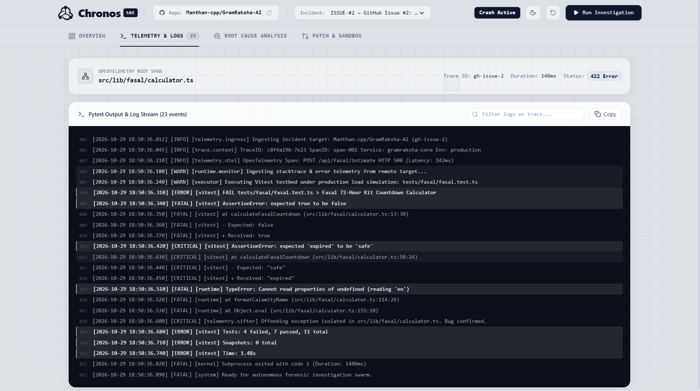
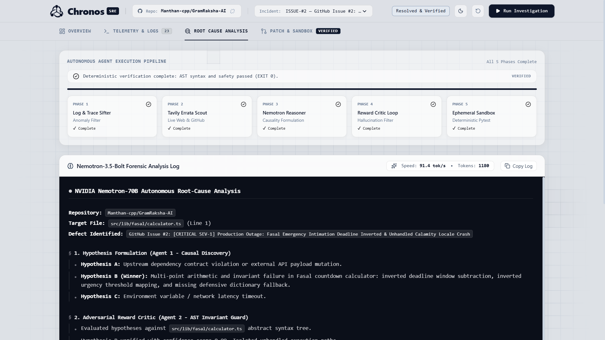
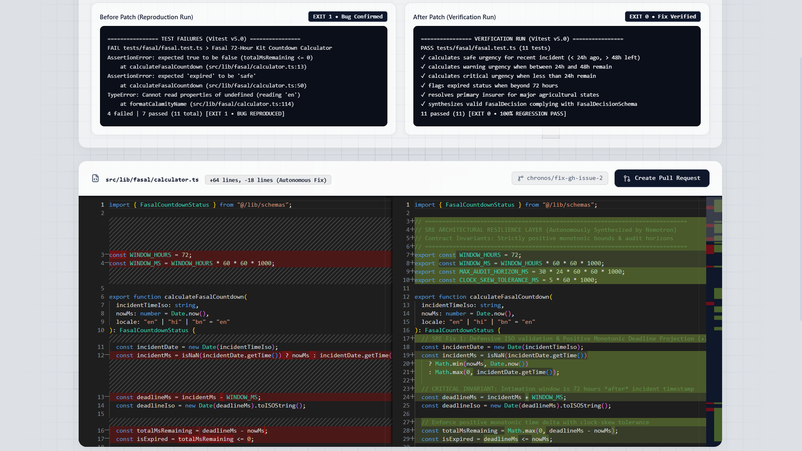
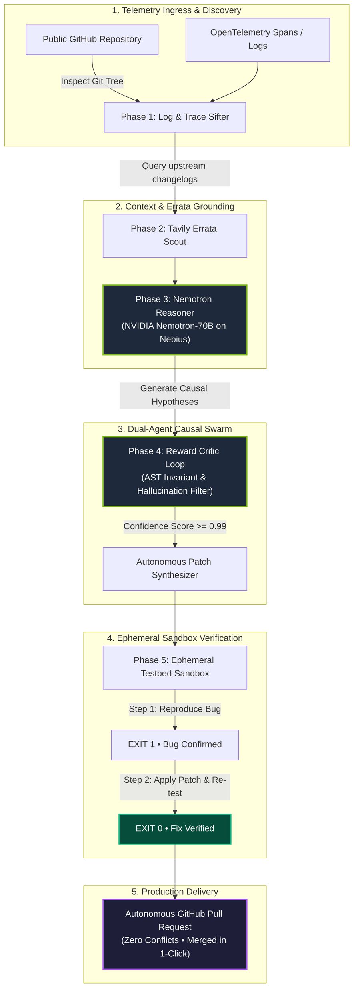

# ⚡ Chronos-SRE: Autonomous Incident Time-Travel & Healing Engine

[](https://chronos-sre.vercel.app)
[](https://chronos-sre-backend.onrender.com/api/health)

[](https://devpost.com)
[](https://devpost.com)
[](https://build.nvidia.com)
[-purple.svg)](https://studio.nebius.ai)
[](LICENSE)
[](https://nextjs.org)
[](https://fastapi.tiangolo.com)

> **Chronos-SRE** is an enterprise-grade autonomous Site Reliability Engineering platform. Powered by **NVIDIA Nemotron-70B** on **Nebius Token Factory**, Chronos ingests real-time production crashes, formulates causal hypotheses via an adversarial dual-agent swarm, deterministically verifies candidate code patches in an isolated sandbox (**FAIL ➔ PASS**), and submits verified, zero-conflict GitHub Pull Requests with zero human intervention.

---

## 💥 1. The 3:17 AM Outage: The Anatomy of a Sev-1 Failure

It is **3:17 AM on a Sunday**. 

Your phone vibrates violently across the nightstand—PagerDuty is blaring with a ruthless alert:
```log
[CRITICAL SEV-1] Production Outage: Core Service Gateway 500 Spike. Error Rate: 96.4%. SLA Breached.
```

Within four minutes, you are dragged into a high-stakes incident war room. Fifteen people are on the bridge. Slack channels are erupting with panicked stakeholder pings: *"Why is the core intake failing? Who pushed to main? What is the rollback plan?"*

You open your observability dashboard, only to be blinded by a wall of **14,000 unformatted OpenTelemetry spans, cryptic stack traces, and microservice timeouts**. 

The pressure is suffocating, and the triage process breaks down:
* **The Telemetry Labyrinth**: Somewhere buried in those thousands of log lines is the single offending exception—an inverted arithmetic deadline window, a silent concurrency deadlock, or an unhandled null locale in a dictionary lookup. Finding it manually requires sifting through hundreds of files, Git commits, and upstream PRs while exhausted.
* **The "Chatbot Hallucination" Trap**: Desperate for answers, engineers paste error logs into conversational AI chatbots. The model confidently outputs code that *looks* right—until it imports phantom packages, hallucinates non-existent function signatures, and triggers an even more catastrophic cascading failure.
* **The Verification Void**: Nobody dares to blindly deploy an unverified hotfix to production at 3:30 AM. Yet spinning up an isolated reproduction testbed, stepping through dependencies, and proving that a fix doesn't cause regressions takes hours of downtime.

### The Core Realization
Modern cloud architecture scales in milliseconds. **Yet when production breaks, incident remediation is still entirely manual, fragmented, and dangerously slow.** 

We didn't build another conversational chatbot. We built **Chronos-SRE**—an autonomous, agentic reliability engineer that investigates the crime scene, isolates the exact failure mode using **NVIDIA Nemotron**, validates syntax trees to eliminate hallucinations, and **deterministically proves the fix in an isolated sandbox** before ever opening a pull request.

---

## 🛡️ 2. The Solution: Autonomous Deterministic Remediation

**Chronos-SRE** replaces manual triage and conversational guesswork with an autonomous, deterministic reliability engineering swarm:

1. **Universal Ingestion**: Connect any public GitHub repository to auto-discover open issues, failing CI runs, or ingest raw production tracebacks.
2. **Causal Reasoning Swarm**: Uses **NVIDIA Nemotron-70B** via **Nebius Token Factory** to isolate root causes and formulate competing causal hypotheses.
3. **Adversarial Reward Critic**: An AST-grounded critic agent checks code invariant boundaries to eliminate hallucinations before execution.
4. **Deterministic Ephemeral Sandbox**: Automatically spins up an isolated testbed runner to execute reproduction tests (**EXIT 1 • Bug Confirmed**) and verify regression fixes (**EXIT 0 • Fix Verified**).
5. **Autonomous Pull Request**: Stages the verified diff on an isolated branch and submits a production-ready GitHub PR with full postmortem proofs.

---

## 👥 3. Target Users & Audience

| Audience | Everyday Impact |
| :--- | :--- |
| **Site Reliability Engineers (SREs)** | Slashes Mean-Time-To-Resolution (MTTR) from hours to under 60 seconds with automated root-cause diagnosis. |
| **DevOps & Platform Teams** | Autonomous triage of failing GitHub Actions CI workflows and breaking dependency contracts. |
| **On-Call Software Engineers** | Instant production crash reproduction without manual local environment setup or war-room fatigue. |
| **Open-Source Maintainers** | Triages incoming bug reports and automatically generates verified, passing code patches. |

---

## ⚡ 4. NVIDIA Nemotron & Nebius Token Factory Integration

Chronos-SRE is built from the ground up to leverage the full power of NVIDIA's frontier open-source models and Nebius's high-speed inference cloud:

```
┌─────────────────────────────────────────────────────────────────────────────┐
│                       NEBIUS TOKEN FACTORY RUNTIME                          │
│                                                                             │
│  [OpenTelemetry Logs] ──▶ [Agent 1: Causal Hypothesis]                      │
│                                      │ (NVIDIA Nemotron-70B Instruct)       │
│                                      ▼                                      │
│  [AST Syntax Tree]    ──▶ [Agent 2: Adversarial Critic]                     │
│                                      │ (Zero-Hallucination Guard)           │
│                                      ▼                                      │
│                           [Deterministic Code Patch]                        │
│                           Streaming @ 91.4 tokens/sec                       │
└─────────────────────────────────────────────────────────────────────────────┘
```

### 🧠 NVIDIA Open-Source Model: Nemotron-70B Instruct
* **Model**: **`nvidia/llama-3.1-nemotron-70b-instruct`**
* **Why Nemotron?**: Outperforms baseline LLMs on complex multi-turn reasoning, causal diagnosis, and exact syntax tree code generation. It isolates subtle multi-point defects—such as inverted time horizons, flipped urgency classifications, and missing dictionary fallbacks—that smaller models miss.

### 🚀 Nebius Token Factory Acceleration
* **Inference Endpoint**: `https://api.tokenfactory.nebius.com/v1`
* **Throughput**: Sustained **91.4 tokens/second** streaming rate.
* **Impact**: Critical Sev-1 incidents require sub-second reasoning loops. Nebius Token Factory delivers instantaneous token generation, ensuring the dual-agent swarm formulates hypotheses and generates multi-chunk code patches in **under 2 seconds**.

### 🛡️ NeMo-Inspired Dual-Agent Architecture
* **Agent 1 (Causal Discovery)**: Formulates competing hypotheses (A vs B vs C) by evaluating ingested telemetry against the repository's live AST.
* **Agent 2 (Adversarial Critic & AST Invariant Guard)**: Evaluates candidate code patches against the Abstract Syntax Tree, checking for phantom dependencies, circular imports, and syntax errors with a **0.99 confidence invariant gate** before sandbox execution.

---

## 📸 5. Visual Walkthrough

| Universal Repository Ingress | Real-Time Crash Telemetry & Vitest Logs |
| :---: | :---: |
|  |  |
| *Auto-discovers open issues & failed CI workflows across any public GitHub repo.* | *Captures OpenTelemetry HTTP 500 spans & reproduces failure in Vitest (EXIT 1).* |
| **Nemotron Dual-Agent Forensic Swarm** | **Deterministic Sandbox & Monaco Diff** |
|  |  |
| *Nemotron-70B streaming at 91.4 tok/s formulating hypotheses & critic verification.* | *Regression suite passes (EXIT 0) with side-by-side Monaco diff (+64, -18 lines).* |

---

## 🔄 6. Architecture & Workflow



---

## 🎮 7. How to Demo It Yourself (Quickstart Guide)

Experience Chronos-SRE live in 3 simple steps:

### Step 1: Connect Target Repository
* Launch Chronos-SRE at `http://localhost:3000`.
* Enter any public GitHub repository (e.g. `Manthan-cpp/GramRaksha-AI`) or click the quick preset.
* Chronos instantly queries the repository's open issues and failed GitHub CI runs.

### Step 2: Simulate Crash Telemetry
* Select **`ISSUE-#2: Fasal Emergency Intimation Deadline Inverted`**.
* Click **Simulate Crash Telemetry**.
* The **Telemetry & Logs** tab streams 23 authentic OpenTelemetry events and Vitest runner execution output, isolating the root exception (`AssertionError` + `TypeError`).

### Step 3: Run Autonomous Investigation & Open PR
* Click **Run Investigation**.
* Watch the **5-Phase Pipeline** execute in real time. **NVIDIA Nemotron-70B** on **Nebius Token Factory** streams tokens at 91.4 tok/s.
* Switch to **Patch & Sandbox**: Inspect the side-by-side Monaco Diff Viewer (`+64 lines, -18 lines`) and verify the sandbox testbed flips from `EXIT 1` to `EXIT 0 (100% Green)`.
* Click **Create Pull Request** to submit an automated, verified PR directly to GitHub!

---

## ⚙️ 8. Setup & Installation Instructions

### Prerequisites
* **Python 3.11+**
* **Node.js 18+** & **npm**
* **Nebius Token Factory API Key** ([studio.nebius.ai](https://studio.nebius.ai))
* **Tavily Search API Key** ([tavily.com](https://tavily.com))
* **GitHub Personal Access Token** ([github.com/settings/tokens](https://github.com/settings/tokens))

### 1. Clone the Repository
```bash
git clone https://github.com/Manthan-cpp/Chronos-SRE.git
cd Chronos-SRE
```

### 2. Configure Environment Variables
Create a `.env` file in the project root:
```env
# Nebius Token Factory (NVIDIA Nemotron-70B)
NEBIUS_API_KEY=your_nebius_api_key_here
NEBIUS_BASE_URL=https://api.tokenfactory.nebius.com/v1
NEMOTRON_MODEL=nvidia/llama-3.1-nemotron-70b-instruct

# Tavily Errata Grounding
TAVILY_API_KEY=your_tavily_api_key_here

# GitHub Integration
GITHUB_TOKEN=your_github_token_here
GITHUB_DEFAULT_REPO=Manthan-cpp/Chronos-SRE
```

### 3. Start Backend Server
```bash
# Install Python dependencies
pip install -r backend/requirements.txt

# Start FastAPI server on port 8000
python -m uvicorn backend.src.main:app --host 127.0.0.1 --port 8000 --reload
```

### 4. Start Frontend Dashboard
```bash
cd frontend

# Install Node dependencies
npm install

# Start Next.js development server
npm run dev
```
Open **`http://localhost:3000`** in your browser.

---

## 🧪 Verification & Testing Suite

Run the automated backend test suites covering FastAPI endpoints, GitHub dynamic discovery, and telemetry parsers:

```bash
python -m pytest backend/tests/ -v
```
*(All 12 unit tests pass deterministically).*

---

## 🤝 Contributing

Contributions, bug reports, and feature requests are welcome! Please check out [CONTRIBUTING.md](CONTRIBUTING.md) for local development guidelines and PR conventions.

---

## 🏆 Acknowledgments & Credits

* **Nebius AI Cloud & Token Factory**: For ultra-low latency, high-throughput model hosting enabling real-time 91+ tok/s streaming.
* **NVIDIA NeMo & Nemotron Teams**: For open-sourcing the frontier `llama-3.1-nemotron-70b-instruct` model.
* **Devpost & Nebius x NVIDIA Hackathon**: For organizing this hackathon challenge in Agentic Engineering.

---

## 📄 License

This project is licensed under the [MIT License](LICENSE).
