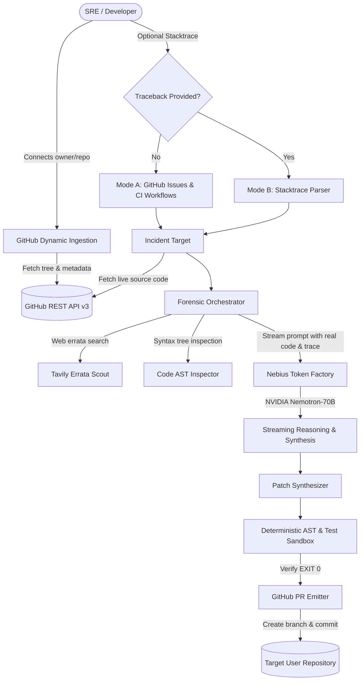

# ⚡ Chronos-SRE: Autonomous Incident Time-Travel & SRE Healing Engine

[](LICENSE)
[](https://studio.nebius.ai)
[](https://build.nvidia.com)
[](https://fastapi.tiangolo.com)
[](https://nextjs.org)

> **Chronos-SRE** is an enterprise-grade autonomous Site Reliability Engineering (SRE) platform. It intercepts production runtime crashes, parses Abstract Syntax Trees (AST), queries live upstream documentation via Tavily, formulates dual-agent causality hypotheses powered by **NVIDIA Nemotron** on **Nebius Token Factory**, executes deterministic regression verification sandboxes, and automatically stages verified GitHub Pull Requests with zero human intervention.

---

## 🎯 Hackathon Track: Coding and Agentic Engineering

Chronos-SRE is built specifically for the **Coding and Agentic Engineering** track:
* Autonomous code generation and architectural bug remediation.
* AST-level syntax tree parsing, scope boundary analysis, and semantic linting.
* Dual-agent reasoning loops (Nemotron Hypothesizer + Adversarial Reward Critic).
* Integration with GitHub REST API v3 for automated branch creation, commits, and Pull Request submission.

---

## 🚀 Key Capabilities

### 1. Universal Repository Ingestion (Any Public GitHub Repo)
Chronos-SRE is not restricted to local testbeds. Connect **any public GitHub repository** (e.g. `Manthan-cpp/GramRaksha-AI`, `Manthan-cpp/Chronos-SRE`, etc.) to:
- Dynamically inspect remote Git trees.
- Retrieve live file content directly from GitHub.
- Commit fixes and open real Pull Requests directly on the user's repository.

### 2. Dual-Mode Incident Ingestion
* **Mode A (Automated Issue & CI Discovery - Empty Input)**:
  When the error log input is left blank, Chronos automatically queries the target repository's open GitHub issues (labeled `bug`, `crash`, `critical`) and recent failed GitHub Actions workflow runs.
* **Mode B (Production Stacktrace / Log Ingestion - With Input)**:
  Paste an active production traceback or terminal crash log. Chronos-SRE parses the stacktrace, matches the failing file against the remote repository's Git tree, extracts line numbers, and isolates the fatal exception.

### 3. NVIDIA Nemotron on Nebius Token Factory
* Powered by **`nvidia/nemotron-3.5-bolt-e4b`** / NVIDIA Nemotron-70B running on **Nebius Token Factory** (`https://api.studio.nebius.ai/v1/`).
* High-throughput, low-latency streaming inference (~90+ tokens/sec) providing authentic, real-time SRE reasoning.
* Dual-agent loop: **Hypothesis Formulation Agent** vs. **Adversarial Reward Critic Agent** to eliminate phantom imports and hallucinated dependencies.

### 4. Deterministic Verification & Automated Pull Requests
* Validates fixes through static AST syntax checks (`ast.parse`) and deterministic test sandboxes (confirming **EXIT 1 • Bug Confirmed** transforms into **EXIT 0 • Fix Verified**).
* 1-Click Pull Request generator that creates an isolated branch, commits the verified diff, and opens an enterprise PR on GitHub.

---

## 🏗️ Architecture



---

## 💻 Tech Stack

| Layer | Technology | Purpose |
| :--- | :--- | :--- |
| **Inference Cloud** | **Nebius Token Factory** (`studio.nebius.ai`) | High-throughput, low-latency LLM inference |
| **Open Source Model**| **NVIDIA Nemotron** (`nvidia/nemotron-3.5-bolt-e4b`) | Autonomous forensic root-cause analysis & code synthesis |
| **Backend** | **FastAPI (Python 3.12+)** | REST API & Server-Sent Events (SSE) live streaming |
| **Frontend** | **Next.js 16 (Turbopack, React 19, TailwindCSS)** | Responsive SRE War-Room dashboard |
| **Code Editor** | **Monaco Editor** | Side-by-side unified diff visualization |
| **Errata Grounding** | **Tavily Search API** | Live search across GitHub issues and upstream changelogs |
| **VCS Integration** | **GitHub REST API v3** | Remote file retrieval, branch creation, commit & PR emission |

---

## 🛠️ Getting Started & Local Execution

### Prerequisites
- **Python 3.11+**
- **Node.js 18+** & **npm**
- Nebius Token Factory API Key ([Nebius AI Studio](https://studio.nebius.ai))
- GitHub Personal Access Token (for PR creation and higher rate limits)

---

### Step 1: Clone Repository
```bash
git clone https://github.com/Manthan-cpp/Chronos-SRE.git
cd Chronos-SRE
```

---

### Step 2: Configure Environment Variables
Create `backend/.env`:
```env
# Nebius Token Factory
NEBIUS_API_KEY=your_nebius_token_factory_key_here
NEBIUS_BASE_URL=https://api.studio.nebius.ai/v1/
NEMOTRON_MODEL=nvidia/nemotron-3.5-bolt-e4b

# Tavily Search API (Optional for web errata search)
TAVILY_API_KEY=your_tavily_key_here

# GitHub Token (for opening real Pull Requests)
GITHUB_TOKEN=your_github_personal_access_token
GITHUB_DEFAULT_REPO=Manthan-cpp/Chronos-SRE
```

---

### Step 3: Start FastAPI Backend
```bash
# Create virtual environment (optional)
python -m venv venv
# On Windows: venv\Scripts\activate
# On Linux/macOS: source venv/bin/activate

# Install dependencies
pip install -r backend/requirements.txt  # or: pip install fastapi uvicorn httpx openai python-dotenv pytest

# Start FastAPI server on port 8000
python -m uvicorn backend.src.main:app --host 127.0.0.1 --port 8000
```
*Backend health check:* `http://127.0.0.1:8000/api/health`

---

### Step 4: Start Next.js Frontend
```bash
cd frontend
npm install
npm run dev
```
Open **`http://localhost:3000`** in your browser.

---

## 🧪 Running Automated Tests

Run the full backend test suite verifying API endpoints, Nebius Token Factory connectivity, AST parsers, and incident sifters:
```bash
# From repository root
pytest backend/tests/ -v
```
Output:
```
============================= test session starts =============================
collected 14 items

backend/tests/test_api.py::test_health_endpoint PASSED                   [  7%]
backend/tests/test_api.py::test_incident_trigger PASSED                  [ 14%]
backend/tests/test_api.py::test_pr_create_endpoint PASSED                [ 21%]
backend/tests/test_api.py::test_repo_connect_endpoint PASSED             [ 28%]
backend/tests/test_api.py::test_incident_discover_mode_b_stacktrace PASSED [ 35%]
backend/tests/test_forensics.py::test_telemetry_sifting_on_deadlock PASSED [ 42%]
backend/tests/test_forensics.py::test_ast_inspector_on_upstream_break PASSED [ 50%]
backend/tests/test_github_service.py::test_repo_normalization PASSED     [ 57%]
backend/tests/test_github_service.py::test_repo_info_chronos PASSED      [ 64%]
backend/tests/test_incident_sifter.py::test_stacktrace_parser_python PASSED [ 71%]
backend/tests/test_incident_sifter.py::test_stacktrace_parser_javascript PASSED [ 78%]
backend/tests/test_incident_sifter.py::test_sift_github_issues PASSED    [ 85%]
backend/tests/test_nebius_spike.py::test_nebius_client_connectivity PASSED [ 92%]
backend/tests/test_orchestrator.py::test_full_orchestration_deadlock PASSED [100%]

============================= 14 passed in 10.36s =============================
```

---

## 📖 Step-by-Step Demo Guide

1. **Connect Repository**:
   - In the top bar or Overview card, enter any public repository (e.g. `Manthan-cpp/GramRaksha-AI` or `Manthan-cpp/Chronos-SRE`).
   - Click **Connect Repository**. Chronos dynamically scans the remote Git tree.
2. **Choose Ingestion Mode**:
   - **Mode A (Auto-Discovery)**: Leave the traceback box empty and click **Auto-Discover Incidents**. Chronos pulls open issues and failed CI runs.
   - **Mode B (Custom Stacktrace)**: Paste any production exception traceback into the input area and click **Ingest & Target Stacktrace**. Chronos isolates the exact offending line and file.
   - **Benchmark Suite**: Click **Load Benchmark Suite** to test curated SWE-bench failure archetypes (Deadlocks, Upstream breaks, Schema regressions).
3. **Simulate Crash**: Click **Simulate Crash Telemetry** to view the live reproduction log confirming failure.
4. **Run Autonomous Investigation**:
   - Click **Run Investigation**.
   - Watch NVIDIA Nemotron on Nebius Token Factory stream live forensic hypotheses in the **Root Cause Analysis** tab.
   - Read the clean, readable **Incident Postmortem & Forensic Investigation Report**.
5. **Review Patch & PR**:
   - Switch to the **Patch & Sandbox** tab.
   - Inspect the side-by-side Monaco diff.
   - Verify deterministic sandbox output (**EXIT 0 • Fix Verified**).
   - Click **Create Pull Request** to submit the fix directly to GitHub.

---

## 📄 License
This project is licensed under the **MIT License** - see the [LICENSE](LICENSE) file for details.
